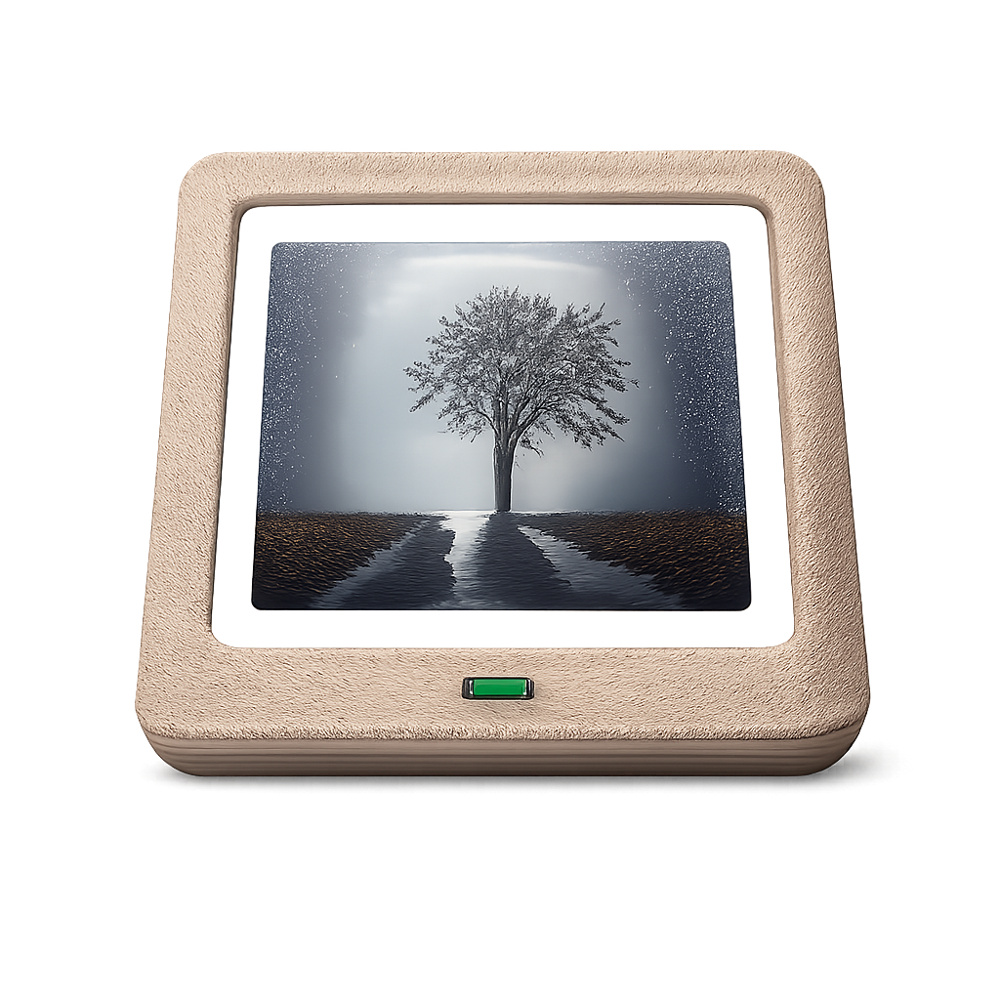

# OpenPhotoFrame

<p align="center">
  
</p>

**Turn your old Android tablet into a beautiful digital photo frame.**

OpenPhotoFrame is a free, open-source slideshow app that syncs photos from your private cloud (Nextcloud) or local storage. No ads, no subscriptions, no nag screens – just your photos.

## ✨ Features

- **🖼️ Beautiful Slideshow** – Smooth crossfade transitions between your photos
- **☁️ Nextcloud Sync** – Sync photos from a Nextcloud public share link (WebDAV)
- **📁 Local First** – Works offline, photos are cached locally
- **⚙️ Simple Settings** – Configure slide duration, transition speed, and sync interval
- **🌙 Always On** – Designed to run 24/7 as a dedicated photo frame
- **🔒 Privacy First** – Your photos stay on your server, no third-party cloud required

## 🚀 Why OpenPhotoFrame?

Existing apps like *Fotoo* or *PhotoCloud Frame Slideshow* are either:
- Riddled with **ads and nag screens**
- Require **paid subscriptions** for basic features
- Force you to use **public cloud services** (Google Photos, etc.)

OpenPhotoFrame is different:
- ✅ **100% Free & Open Source** (GPLv3)
- ✅ **No ads, no in-app purchases, no tracking**
- ✅ **Works with your self-hosted Nextcloud**
- ✅ **Simple & focused** – does one thing well (KISS principle)

## 📦 Installation

### Android
*Coming soon to F-Droid*

For now, build from source (see Development section).

### Linux (for Development/Testing)
```bash
flutter run -d linux
```

## 🔄 Automatic Updates

OpenPhotoFrame can update itself from GitHub releases. It is **opt-in** and **off by default** — enable it at the bottom of **Settings → Automatic updates**. This is only for installs from GitHub; if you installed via F-Droid, leave it off and update through F-Droid instead.

When enabled, the app checks the latest GitHub release roughly every 8 hours:

- **Default:** when a newer version is found you get a prompt to *Skip* or *Download & install*. Android then shows its install confirmation (you may need to allow "Install unknown apps" once).
- **Silent:** if the app is the device's **Device Owner**, updates download and install silently in the background with no prompt — ideal for a wall-mounted frame you never touch.

### Silent updates via Device Owner

Device Owner is Android's device-management mode. It is what lets the app install updates without any confirmation dialog. It can only be set on a device with **no accounts** (e.g. right after a factory reset), via ADB:

```bash
adb shell dpm set-device-owner io.github.micw.openphotoframe/.ScreenAdminReceiver
```

Then enable **Settings → Automatic updates → Install without confirmation**. To remove it again later:

```bash
adb shell dpm remove-active-admin io.github.micw.openphotoframe/.ScreenAdminReceiver
```

> Updates only install over an existing app when signed with the same key. The project's reproducible builds ensure the GitHub APKs match the F-Droid signing key, so switching between them keeps your data.

## 🛠️ Development

### Requirements
- Flutter SDK (3.x)
- Dart SDK

### Build & Run
```bash
# Clone the repository
git clone https://github.com/micw/OpenPhotoFrame.git
cd OpenPhotoFrame

# Get dependencies
flutter pub get

# Run on Linux (fast iteration)
flutter run -d linux

# Run on connected Android device
flutter run -d <device-id>
```

### Updating the App Icon
To update the app icon, replace `assets/icon.png` with your new icon (recommended: 1024x1024 PNG), then run:
```bash
dart run flutter_launcher_icons
cp assets/icon.png fastlane/metadata/android/en-US/images/icon.png
```
This generates icons for all platforms (Android, iOS, Web, Windows, macOS, Linux) and updates the F-Droid metadata.

### Architecture
The app follows a **Local First** architecture with clean separation of concerns:

- **Player (UI)** – Displays photos from a local directory with smooth transitions
- **Syncer (Service)** – Downloads photos from cloud sources in the background
- **Repository Pattern** – Abstracts storage access
- **Strategy Pattern** – Swappable playlist algorithms (random, weighted freshness)

## ⚙️ Configuration

Tap the center of the screen during slideshow to open settings:

| Setting | Description |
|---------|-------------|
| Slide Duration | How long each photo is shown (1-900 sec) |
| Transition Duration | Crossfade animation speed (0.5-5 sec) |
| Sync Source | None or Nextcloud public share link |
| Sync Interval | Auto-sync frequency (disabled, or 5-60 min) |
| Delete Orphaned Files | Remove local photos deleted from server |

### 💡 Tip: Enter URL via ADB

If typing the Nextcloud URL on a tablet is cumbersome, you can paste it via ADB:

```bash
# Focus the URL input field on the tablet, then run:
adb shell input text 'https://cloud.example.com/s/YOUR_SHARE_TOKEN'
```

### 💡 Tip: Disable Lock Screen via ADB

Some Android devices (especially Huawei with EMUI) don't allow disabling the lock screen in the settings UI. You can disable it via ADB:

```bash
adb shell locksettings set-disabled true
```

## 🤝 Contributing

Contributions are welcome! Please read [CONTRIBUTING.md](CONTRIBUTING.md) before submitting a pull request.

## 📄 License

This project is licensed under the **GNU General Public License v3.0**.

See the [LICENSE](LICENSE) file for details.
